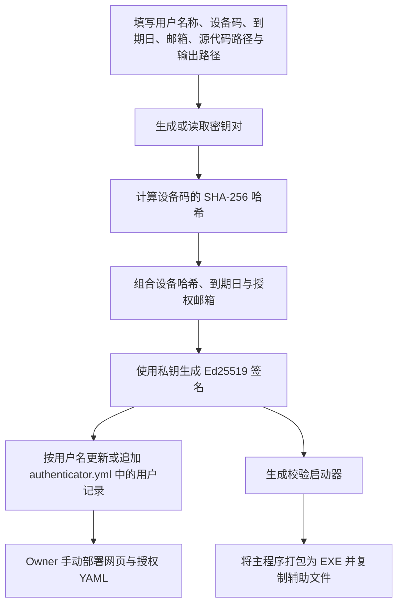
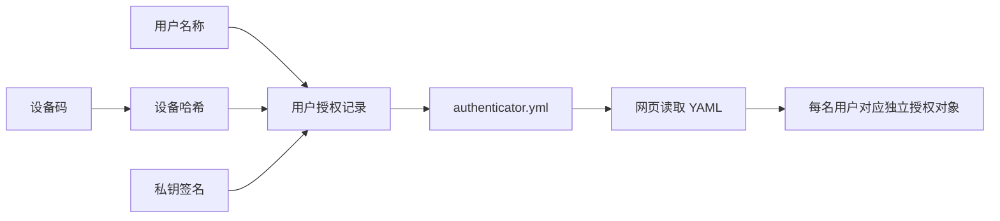
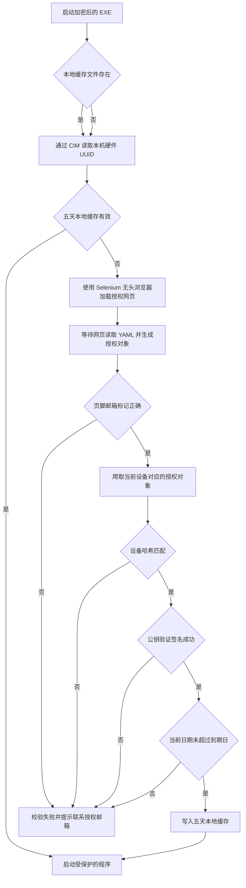
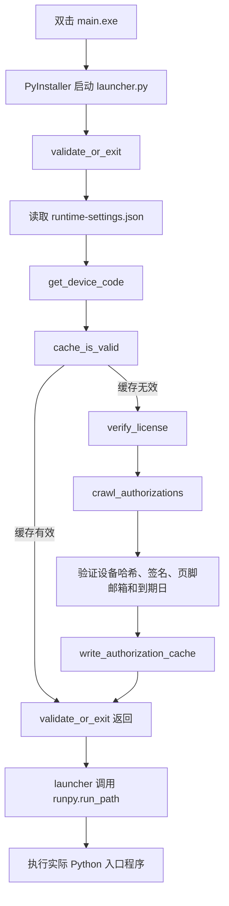

# 代码加密与授权工具

## 整体流程



## 授权信息同步



`authenticator.yml` 的 `USER` 是用户列表。为已有名称再次签发授权时，只更新该用户；使用新名称时，新增一条用户记录。

授权载荷包含设备哈希、到期日和 Owner 邮箱；这些内容均受签名保护。运行时用授权载荷中的 Owner 邮箱校验网页 footer 的 `data-encryption="planned"` 对应邮箱；校验失败时的联系邮箱以网页 footer 爬取值为准。

## EXE 运行校验



校验失败时，程序会弹出错误提示窗口，显示失败原因与以下联系信息：

```text
Please contact: 授权邮箱
```

## EXE 启动函数顺序

双击 `main.exe` 后，PyInstaller 先启动打包时生成的 `launcher.py`。实际业务入口文件在授权完成前不会执行。



因此，授权校验阶段的第一个函数是 `validate_or_exit()`；在实际程序执行前，最后一个授权函数是 `validate_or_exit()` 的返回。随后启动器调用 `runpy.run_path(...)`，这一步才开始执行所选 `.py` 入口文件。

## 使用要点

- 程序只更新本地 `authenticator.yml`；Owner 需手动提交并发布网页与该文件，再分发 EXE。
- `Python entry file` 与 `Encrypted output` 必须填写相对于项目根目录的路径；工具不会访问项目目录以外的文件。
- EXE 默认输出至项目根目录的 `Output/<入口文件父目录名>/main.exe`，并保留同级 `_internal` 运行时目录；分发时必须保留整个输出目录。入口文件父目录内全部 `.py` 文件及 `license_guard.py` 会递归扫描导入并自动收集第三方包，CSV、JSON 等其他辅助文件会保持原有目录结构复制到输出目录，打包临时文件会自动删除。
- EXE 会通过 `Get-CimInstance Win32_ComputerSystemProduct` 主动读取本机硬件 UUID；签发授权时，设备码应使用该命令输出的 UUID。
- 首次在线验证成功后，EXE 会在本地应用数据目录创建由 Windows DPAPI 加密的授权缓存。缓存绑定设备、公钥和 License 到期日，最长有效期为 5 天；缓存有效时不访问授权网页。重新打包不会删除该缓存。
- 私钥位于当前用户的本地应用数据目录 `Python Code Encrypter/keys`，文件名包含用户名称，只保留在授权方，不能随 EXE 分发。
- 页脚邮箱、设备哈希、签名和到期日校验均为强制项，无法在前台或运行时配置中关闭。